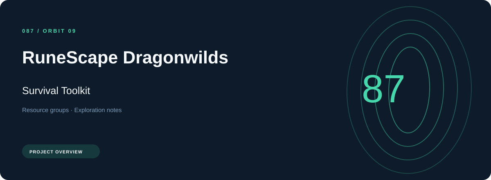
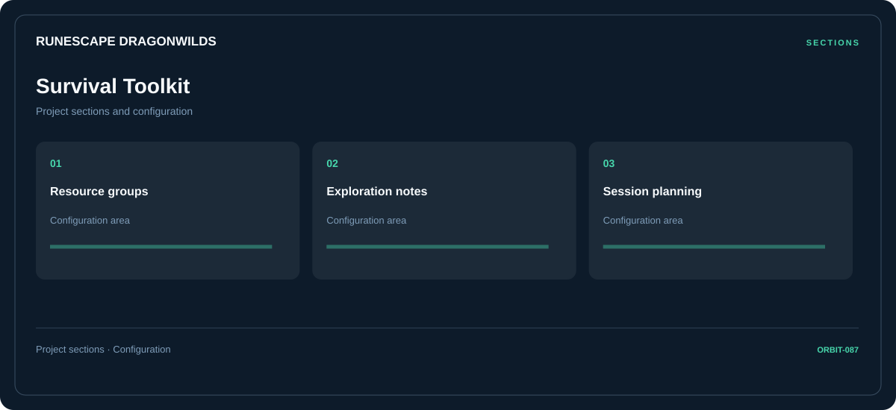

# 🧭 RuneScape Dragonwilds Survival Toolkit

**Resource groups · Exploration notes · Session planning**

## ⚡ Features

The RuneScape Dragonwilds survival toolkit workflow separates resource groups from exploration notes and session planning. Named sections make the available options easier to find.

### ⚙️ Resource groups

Inventory and resource categories organized alongside their related values and notes.

### 🧩 Exploration notes

A dedicated section for exploration notes and the configuration details associated with that area.

### ⌨️ Session planning

Session and activity information grouped by the task or context it belongs to.

## 🖥️ Project navigation

## 📥 Download

The button and cover open the project's download page. Use the information supplied with the downloaded package for installation and release-specific requirements.

## 📚 Project documentation

- [Feature reference](docs/FEATURES.md)
- [Download information](docs/DOWNLOAD.md)
- [Project page](index.html)

---

RuneScape Dragonwilds Survival Toolkit · Program documentation and download information.
